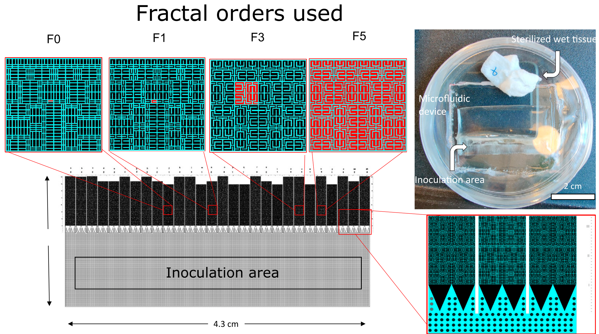

# Section one



## Single column {.smaller}

- Bullet points appear one by one (`incremental: true`)
- Text wraps automatically and shrinks slightly if it would overflow
- Images are left-aligned: `{width=50%}`

::: cites
@arellano-caicedo_2021 @orrCoexistenceTheoryMicrobial2025
:::

## Writing slides

- `# Heading` makes a section slide. Add `` right after it for the image on the right.
- `## Heading` makes a single-column slide.
- For two columns, use the `.columns` and `.column` divs. The default is a fixed 50/50 split, and `{.cols-auto}` on the heading lets the image column adapt to the image.
- `## Heading {.image-slide}` centers the image with the caption below it.
- Put citations in a div at the end of each slide, written as `@key1 @key2`. The footer shows them as "Author et al. (2026), …", and the page number stays fixed at the right edge. Slides without citations show only the number.
- The `## References` slide with `::: {#refs}` fills in automatically.

## Resizing images

- `{width=60%}` sets the size relative to the column or slide.
- `{height=500px}` sets a fixed height.
- `{.fit}` fills the available box and keeps the aspect ratio.
- `{fig-align="center"}` centers one figure. Images are left-aligned by default, and centered on image slides.
- Whatever you set, images are capped so they can't leave the slide.

## Things to know

- The overflow control shrinks the font in steps down to 55%. If a slide still doesn't fit, split it.
- The two-column "auto" mode uses CSS :has(), so you need a recent Chrome, Edge, Safari or Firefox.
- The logo and title image are loaded by the script, so Quarto doesn't copy them automatically. Keep them next to the output HTML and list them under `resources:`.

## Two columns (fixed 50/50)

::::: columns
::: column
- Text on the left
- Long lines wrap inside the column
:::

::: column
{.fit}
:::
:::::

::: cites
@smith2026
:::

## Two columns (width adapts to image) {.cols-auto}

::::: columns
::: column
- The text column takes the remaining space
- The image column is as wide as the image allows
:::

::: column
{.fit}
:::
:::::

::: cites
@lee2025 @miller2024
:::

## Image slide {.image-slide}


::: cites
@miller2024
:::

## References {.smaller}

::: {#refs}
:::

```{=html}
<!--
RESIZING IMAGES
  {width=60%}        relative to the column / slide
  {height=500px}     fixed height
  {.fit}             fill the available box (keeps aspect ratio)
  {fig-align="center"}  alignment (default: left; centered on image slides)

SHORTCUTS (during the presentation)
  L  laser pointer on/off      D  light/dark toggle

SLIDE TYPES
  (title)                      generated from the YAML header
  # Heading                    section slide (add  for right-hand image)
  ## Heading                   single-column slide
  ## Heading {.cols-auto}      two-column slide with image-adaptive widths
  ## Heading {.image-slide}    centered image + caption
  ::: {.cites} @key1 @key2 ::: slide citations (footer, bottom right)
-->
```
